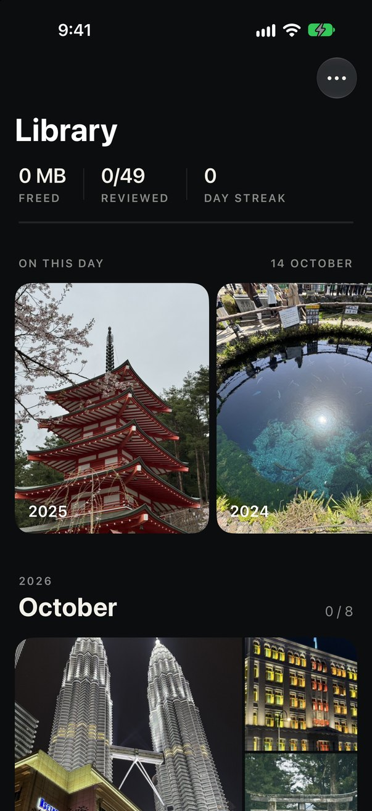
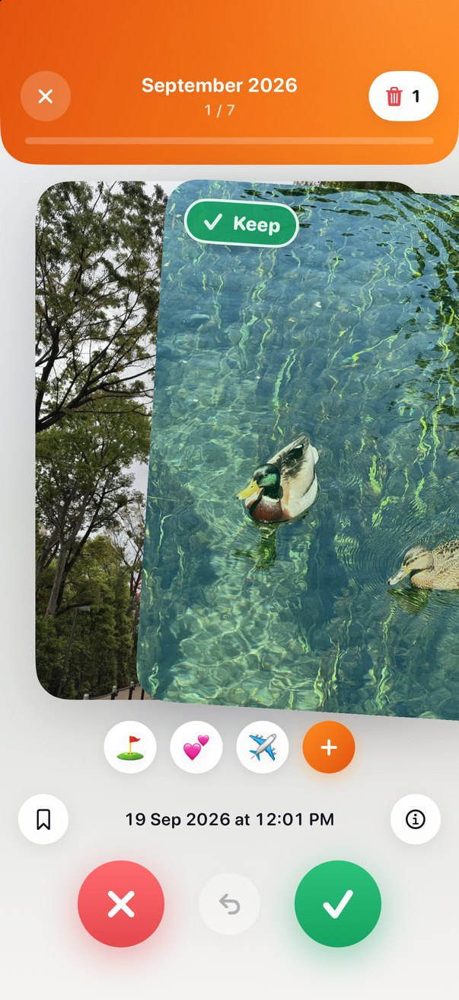
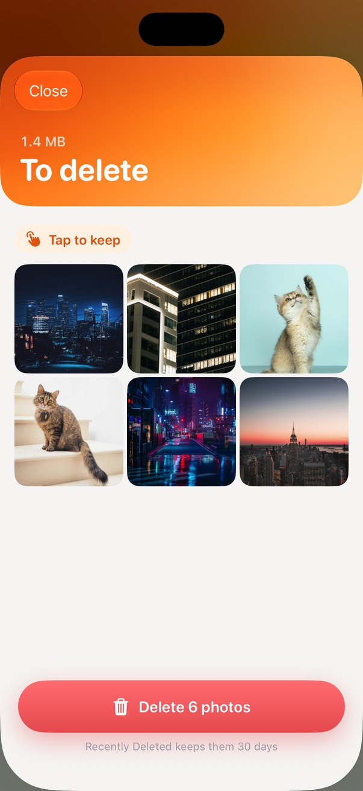

<p align="center"></p>

# 📸 Photo Swipe

> **Clear out your camera roll by swiping. Right keeps a photo, left bins it, and nothing is deleted until you've looked over the pile.**
> Free, no ads, no account, no subscription. **Your photos never leave your phone.**

[](#-install-step-by-step)
[](#-how-it-was-built)
[](#-is-it-safe)
[](#-getting-updates)
[](LICENSE)
[](https://www.warrenlimzf.com/photo-swipe/)

<p align="center">
  
  
  
  
</p>

---

## ⏱️ 30-second version

| | |
|---|---|
| **What is it?** | An iPhone app that shows your photos one at a time so you can keep or bin each with a swipe. |
| **What does it cost?** | Nothing. No ads, no sign-up, no swipe limit. |
| **Can I just download it to my iPhone?** | ❌ No. It is not on the App Store. You build it yourself with a **Mac**, for free. [Why ⬇️](#-read-this-first-it-is-not-on-the-app-store) |
| **How long does setup take?** | About 30 minutes the first time, mostly waiting for Xcode to download. |
| **Is it safe for my photos?** | Yes. It never goes online and cannot delete without your confirmation. [Details](#-is-it-safe) |
| **How do I hear about new versions?** | 🔔 Click **Watch** on this page. It is the only way. [How](#-getting-updates) |

---

## 📖 Table of contents

1. [What it does (and doesn't)](#-what-it-does-and-doesnt)
2. [Read this first: it is not on the App Store](#-read-this-first-it-is-not-on-the-app-store)
3. [Install, step by step](#-install-step-by-step)
4. [Getting updates](#-getting-updates)
5. [The 7-day renewal](#-the-7-day-renewal)
6. [Is it safe?](#-is-it-safe)
7. [How it works](#-how-it-works)
8. [How it was built](#-how-it-was-built)
9. [Troubleshooting](#-troubleshooting)
10. [For developers and AI assistants](#-for-developers-and-ai-assistants)
11. [Credit and licence](#-credit-and-licence)

---

## 🧭 What it does (and doesn't)

**✅ This IS:**
- 👉 **Swipe to sort.** Right keeps, left marks for deletion. There are buttons too.
- ↩️ **Undo.** Step back as many swipes as you like.
- 🗓️ **Month by month.** Your library is split into months, each with a line of progress. Finished months get a tick.
- 🕰️ **On this day.** Photos from today's date in earlier years.
- 🧺 **A review pile.** Marked photos wait in a grid. Tap one to rescue it.
- 🔖 **Bookmarks** for photos you can't decide on yet.
- 📁 **Emoji albums.** Tap ＋ under the photo on the swipe screen to make one, like ✈️ Trips. Tap the emoji, swipe right, and the photo lands in that album in Apple Photos. Undo takes it back out. Open an album to **Select** photos and favourite them, move them to another album, take them out or delete them. (Shared iCloud albums aren't possible: Apple gives apps no access to them.)
- 🎉 **A finish screen** for every month: the tick draws itself, your album emojis burst out, and **Next** takes you straight to the following month.
- 📊 **Stats:** space freed, photos kept and deleted, and a daily streak.

**❌ This is NOT:**
- Not an App Store app. You cannot install it by tapping a link.
- Not a cloud service. There is no server, no account and no upload.
- Not a silent deleter. A swipe only marks a photo. Deleting takes your tap and then Apple's own confirmation.
- Not tested on hundreds of phones. It has been used on one person's iPhone, so go gently the first time.

---

## 🚧 Read this first: it is not on the App Store

Apple only lets apps install with one tap if they come through the App Store, which costs the developer US$99 a year. I haven't paid that, so this app reaches a phone a different way: **you build your own copy from this code.** It is free, but it needs a Mac.

| You have | Can you install it? |
|---|---|
| 💻📱 A Mac and an iPhone | ✅ Yes. Follow the steps below. |
| 📱 An iPhone but no Mac | ❌ No. There is no way to put it on the phone without a Mac. |
| 🪟 A Windows PC | ❌ No. Xcode, Apple's tool for building iPhone apps, only runs on a Mac. |
| 💻 A Mac only | 🟡 You can try it in the iPhone Simulator, but it is built for the phone. |

> ⏳ **Two things to expect on this free route.** The app **stops opening after 7 days** and has to be renewed from your Mac ([how](#-the-7-day-renewal)). And it **does not update itself**: you only hear about new versions if you [watch this repo](#-getting-updates).

---

## 📲 Install, step by step

**You need:** a Mac with about 20 GB free, an iPhone on iOS 18 or later with its cable, and a free Apple ID (the one you already use is fine).

### 1️⃣ Watch this repo first (required)
At the top of this page click **Watch → Custom → tick Releases → Apply**. You need a free GitHub account for this.

> 🔔 **Do not skip this.** There is no App Store to push updates to your phone. A release email from GitHub is the only way you will ever hear about a fix or a new version.

### 2️⃣ Install Xcode (one time ever)
Open the **App Store on your Mac**, search for **Xcode**, and install it. It is made by Apple and it is free. It's a large download. Open it once, accept the licence, and when it offers platforms, keep **iOS** ticked.

### 3️⃣ Download this code (repeat on every update)
Click the green **Code** button on this page, then **Download ZIP**, and unzip it. Or paste this into **Terminal**. It's safe to run again on every update: the first time it downloads the code into your home folder (`~/photo-swipe`, i.e. `/Users/<you>/photo-swipe`), every time after that it replaces it with the latest version, then opens the project in Xcode.

```bash
cd ~ && (git clone https://github.com/warrenlimzf/photo-swipe.git 2>/dev/null || (cd photo-swipe && git fetch && git reset --hard @{u})) && open ~/photo-swipe/PhotoSwipe.xcodeproj
```

> 💡 Replacing the code also resets the Bundle Identifier, so redo step 6 after each update. Your progress in the app lives on your phone and is kept.

### 4️⃣ Open the project
In the folder, double-click **`PhotoSwipe.xcodeproj`**. Xcode opens.

### 5️⃣ Sign in with your Apple ID
Menu bar: **Xcode → Settings → Apple Accounts**, click **+**, and sign in. You are typing into Apple's own software. This project never sees your password.

### 6️⃣ Choose your team, and give the app your own ID (required)
In the left sidebar click the blue **PhotoSwipe** icon at the top. In the middle, under TARGETS, click **PhotoSwipe**, then open **Signing & Capabilities**.

1. In the **Team** menu, pick your name (it says "Personal Team").
2. In **Bundle Identifier**, replace `com.warrenlimzf.photoswipe` with your own, for example `com.yourname.photoswipe`. Lowercase letters, numbers and dots only, no spaces.

> ⚠️ **Don't skip the second part.** Every app ID can only belong to one Apple account, and `com.warrenlimzf.photoswipe` is already mine. If you keep it, Xcode shows two red errors: **"Failed Registering Bundle Identifier … is not available"** and **"No profiles for 'com.warrenlimzf.photoswipe' were found"**. Change the ID, and both disappear (click **Try Again** if they don't clear by themselves).

### 7️⃣ Connect your iPhone
Plug it in, unlock it, and tap **Trust** when it asks.

### 8️⃣ Turn on Developer Mode
On the iPhone: **Settings → Privacy & Security → Developer Mode**. Switch it on, restart when asked, then confirm.

### 9️⃣ Press Run
At the top of the Xcode window, pick your iPhone from the device menu, then press the **Run** button (the triangle ▶).

> 🔑 The first time, your Mac asks for your **Mac login password** (not your Apple ID password) so Xcode can use your signing key. Type it and choose **Always Allow**.

### 🔟 Trust yourself on the iPhone, then allow photos
The first time, the app installs but won't open. Xcode shows **"The application could not be launched because the Developer App Certificate is not trusted"** and the phone says **"Untrusted Developer"**. That's expected: your iPhone just hasn't been told to trust apps you built yourself.

1. Click **OK** on the Xcode message.
2. On the iPhone: **Settings → General → VPN & Device Management**.
3. Under **Developer App**, tap your Apple ID email, then **Trust "…"**, then **Trust** again.
4. Open Photo Swipe from the home screen (or press **Run** again). When it asks about photos, choose **Allow Full Access**.

> ✅ You only do this once per Apple ID. Weekly renewals and updates open straight away.

> 🖼️ With limited access the app only sees the handful of photos you hand-pick, which defeats the point.

**To remove it later:** press and hold the icon and choose **Remove App**, like any other app.

---

## 🔔 Getting updates

**This app cannot update itself.** Automatic updates are an App Store feature, and this is not in the App Store. The copy on your phone stays exactly as it was the day you built it until you rebuild it.

### How to be told when there is a new version
1. Sign in to GitHub (a free account is enough).
2. At the top of this page click **Watch**.
3. Choose **Custom**, tick **Releases**, and click **Apply**.

GitHub will now email you each time a new version is published, with a short note on what changed. Choosing "Releases" only means you get one email per version, not one for every small edit.

Prefer not to make an account? Bookmark the [Releases page](https://github.com/warrenlimzf/photo-swipe/releases) and check it now and then.

### How to update when a release arrives

| You got the code by | Do this |
|---|---|
| **Download ZIP** | Download the new ZIP, open its `PhotoSwipe.xcodeproj`, choose your team again, press **Run**. |
| **Terminal** | Paste the same command from step 3 again, redo step 6, press **Run**. |

No cable needed once you've set up [installing over Wi-Fi](#-skip-the-cable-install-over-wi-fi).

> ✅ **Your progress is kept.** Install over the app that is already on your phone and your decisions, bookmarks and stats stay. Only deleting the app first wipes them.

> 💡 You have to rebuild every 7 days anyway, so the easy habit is: check for a new release, then renew.

---

## 🔁 The 7-day renewal

An app installed with a free Apple ID stops opening after 7 days. That is Apple's limit, not a fault. The icon stays and your data stays.

To renew: plug the iPhone into the Mac, open the project in Xcode, and press **Run** again. It takes about a minute.

### 📶 Skip the cable: install over Wi-Fi

You only need the cable once. After that, renewing and updating can happen over Wi-Fi.

1. With the iPhone plugged in, open **Window → Devices and Simulators** in Xcode.
2. Click your iPhone in the list and tick **Connect via network**.
3. Unplug it. From now on, keep the Mac and iPhone on the **same Wi-Fi**, unlock the phone, pick it at the top of Xcode and press **Run**.

> 💡 This is the same install as with the cable, just without the wire. If the phone shows as "not connected", unlock it and check both are on the same network. The first wireless install can take a little longer.

---

## 🔒 Is it safe?

You are being asked to run a stranger's code against your photo library, so here is what it does and how to check for yourself.

| Question | Answer | How to verify |
|---|---|---|
| 🌐 Can it send my photos anywhere? | **No.** There is no networking code in the app. | Search the `Sources` folder for `URLSession` or `http`: zero results. |
| 📦 Does it include other people's code? | **No.** Only Apple's own frameworks. | `Package.swift` lists zero dependencies. |
| 🗑️ Can it delete without asking? | **No.** You tap Review, then Delete, then iOS shows its own confirmation, which no app can skip. | Read `PhotoLibrary.swift`: it is the only file that touches your library. |
| ♻️ Can I get a deleted photo back? | **Yes,** for 30 days. | They go to **Recently Deleted** in the Photos app. |
| 📝 What does it store? | One small file of your decisions, bookmarks and stats, on the phone. No copies of photos. | `StateFile` in `Sources/SwipeCore`. |
| 🪪 Does it see my Apple ID? | **No.** You sign in to Xcode, which is Apple's software. | Nothing in this repo handles accounts. |
| 👤 Accounts, ads, analytics? | **None.** | Same search as the first row. |

> ⚠️ **Honest limits.** It has been used on one person's phone, not tested across many devices. Check the review grid before you confirm a delete. It comes with no warranty (see the licence).

---

## 🔍 How it works

```
 Your photo library                         One small file on your phone
        │                                              ▲
        ▼                                              │
  PhotoLibrary.swift ──► screens (SwiftUI) ──► rules (SwipeCore) ──► decisions,
  the only file that      library, swipe card,   keep / delete, undo,   bookmarks,
  touches your photos     review grid, stats     months, streak         stats
```

1. **The library** reads your photos through Apple's PhotoKit and groups them by month.
2. **Swiping** records "keep" or "delete" for that photo. Nothing in your library changes yet.
3. **The review grid** shows everything marked for deletion. A tap rescues a photo.
4. **Delete** hands the list to iOS, which asks you to confirm and then moves the photos to Recently Deleted.

A swipe counts the instant you let go. The old card flies off on its own while the next one is already live, so there is never a wait between photos.

---

## 🧰 How it was built

I'm a finance student, not a software engineer. I wrote the brief, made the design calls and tested it on my own phone. **[Claude Code](https://claude.com/claude-code) wrote the Swift.** The first design was thrown out for looking machine-made. The current look, black with the photos edge to edge, was the second attempt. The full story is in the [case study](https://www.warrenlimzf.com/photo-swipe/).

| Piece | What it is |
|---|---|
| 🧡 **Swift** | Apple's programming language |
| 🖼️ **SwiftUI** | Apple's toolkit for screens, animation and gestures |
| 📷 **PhotoKit** | Apple's framework for reading and deleting from the photo library |
| 🔨 **Xcode** | Apple's app that turns the code into something an iPhone can run |
| ✅ **Swift Testing** | 11 automated tests for the swipe, undo, month grouping and streak rules |

---

## 🧯 Troubleshooting

| What you see | What to do |
|---|---|
| **"Untrusted Developer"** when opening the app | iPhone: **Settings → General → VPN & Device Management**, tap your Apple ID, **Trust**. [Step 10](#-trust-yourself-on-the-iphone-then-allow-photos) |
| **The app won't open after about a week** | The 7-day limit. Plug in and press **Run** again. [Details](#-the-7-day-renewal) |
| **"Signing requires a development team"** | You skipped step 6. Pick your name under **Team**. |
| **"Failed Registering Bundle Identifier"** or **"No profiles for 'com.warrenlimzf.photoswipe' were found"** | That ID is taken. Change **Bundle Identifier** to your own, like `com.yourname.photoswipe`, then **Try Again**. [Step 6](#6%EF%B8%8F⃣-choose-your-team-and-give-the-app-your-own-id-required) |
| **"Developer App Certificate is not trusted"** on your Mac | Click OK, then trust yourself on the iPhone. [Step 10](#-trust-yourself-on-the-iphone-then-allow-photos) |
| **The app's photo message mentions only "keep and delete"** | You have an old copy. Download the latest ZIP or `git pull`, then **Run**. Your progress is kept. |
| **A box asks for a password to allow `codesign`** | It wants your **Mac login password**. Type it and click **Always Allow**. |
| **Developer Mode is not in Settings** | It appears after the phone has been connected to Xcode once. Plug in, open Xcode, then look again. |
| **The app only shows a few photos** | Photo access is limited. iPhone: **Settings → Apps → Photo Swipe → Photos → Full Access**. |
| **Your iPhone is not in Xcode's device menu** | Unlock the phone, tap **Trust**, and try a different cable or port. |
| **Xcode says the iPhone is "not connected"** | Plug it in, or set up [Wi-Fi installs](#-skip-the-cable-install-over-wi-fi). Over Wi-Fi the phone must be unlocked and on the same network as the Mac. |
| **The build fails right after an iOS update** | Update Xcode from the Mac App Store, then press Run again. |

Still stuck? [Open an issue](https://github.com/warrenlimzf/photo-swipe/issues) and say what you saw.

---

## 💻 For developers and AI assistants

```
Sources/SwipeCore/      rules only: decisions, session + undo, months, On this day, streak, save file
Sources/PhotoSwipeUI/   every screen (SwiftUI); PhotoLibrary.swift is the only file that touches PhotoKit
App/                    the @main entry point and the icon
Tests/SwipeCoreTests/   Swift Testing tests for SwipeCore
site/                   the case-study page (static HTML)
```

Run the tests on a Mac with Xcode installed:

```bash
./test.sh
```

Build for the simulator from the command line:

```bash
xcodebuild -project PhotoSwipe.xcodeproj -scheme PhotoSwipe -destination "generic/platform=iOS Simulator" CODE_SIGNING_ALLOWED=NO build
```

House rules, if you change it: rules go in `SwipeCore` with a test first, swipes must never wait on an animation, and nothing may add networking. `CLAUDE.md` has the rest.

---

## 📜 Credit and licence

The idea of sorting photos by swiping is not mine. Several App Store apps do it, and this was built after trying one of them. The code, design and icon here were made from scratch and share nothing with those apps.

Released under the [MIT licence](LICENSE): use it, change it, share it, as long as the notice stays.

<sub>Built by <a href="https://www.warrenlimzf.com/">Warren Lim</a> with Claude Code.</sub>
